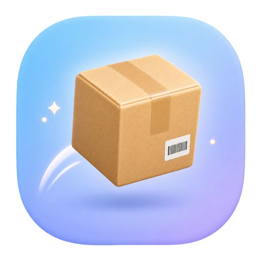
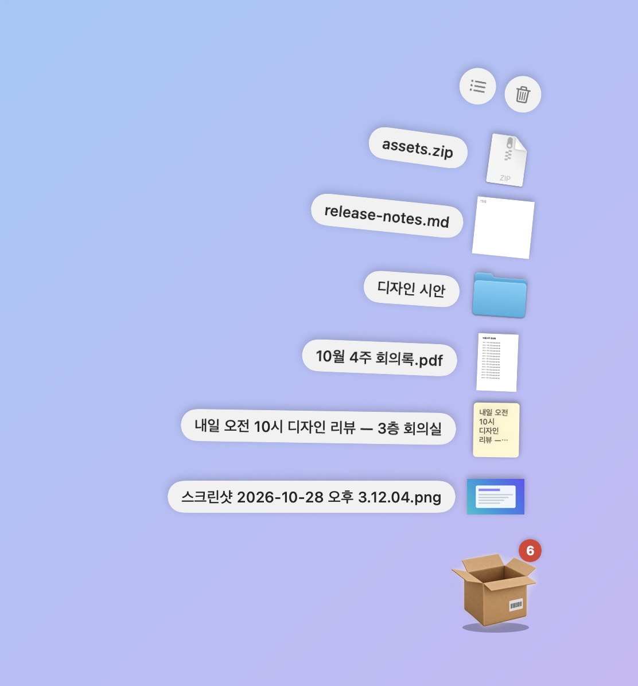

<p align="center"></p>

<h1 align="center">HOPBOX · 택배상자</h1>

<p align="center">맥·윈도우의 전체화면과 데스크톱 사이를 깡충깡충 오가는 작은 택배상자.<br>
한 화면에서 파일·글·이미지를 담고, 다른 화면에서 단축키를 누르면 거기 그대로 있습니다.</p>

<p align="center"><a href="README.md">English</a> · <b>한국어</b></p>

<p align="center">
  <a href="https://github.com/ESeungJun/hopbox/releases/latest/download/Hopbox-macOS-apple-silicon.dmg"><b>⬇ 맥용 받기 (애플 칩)</b></a> ·
  <a href="https://github.com/ESeungJun/hopbox/releases/latest/download/Hopbox-macOS-intel.dmg"><b>⬇ 맥용 받기 (인텔 칩)</b></a><br>
  <a href="https://github.com/ESeungJun/hopbox/releases/latest/download/Hopbox-Windows-x64-Setup.exe"><b>⬇ 윈도우용 받기 (x64)</b></a> ·
  <a href="https://github.com/ESeungJun/hopbox/releases/latest/download/Hopbox-Windows-arm64-Setup.exe"><b>⬇ 윈도우용 받기 (ARM)</b></a><br>
  <sub>맥: 서명·공증 완료, macOS 13 이상 · 윈도우: Windows 10 이상 · <a href="https://github.com/ESeungJun/hopbox/releases">모든 릴리스</a></sub>
</p>

<p align="center"></p>

---

저는 전체화면 앱을 여러 데스크톱에 띄워 놓고 일합니다.
그런데 다른 화면의 파일을 첨부하거나 내용을 옮기려고 끌면, 마우스가 화면 끝에 막혀서 드래그가 끊겨 버립니다.
결국 전체화면을 풀고 창을 늘어놓고 할 일을 한 다음, 다시 전체화면으로 돌아가곤 했습니다.

HOPBOX 는 지금 보고 있는 화면으로 불러올 수 있는 상자입니다.
담고, 화면을 옮기고, 다시 불러서 꺼내면 됩니다.

## 쓰는 법

1. 어디서든 **⌃⌥B**(윈도우는 **Ctrl+Alt+B**)를 누릅니다. 전체화면 앱 위에서도 마우스 옆으로 택배가 툭 떨어집니다.
2. 파일을 상자에 **끌어다 놓거나**, 복사한 것(글·이미지·파일)을 **⌘V**(**Ctrl+V**)로 담습니다.
3. 다른 데스크톱으로 가서 단축키를 다시 누르면 같은 상자가 그 화면으로 배달됩니다.
4. 상자를 누르면 Dock 스택처럼 부채꼴로 펼쳐집니다.
   항목을 **끌어서** 첨부하거나, **눌러서** 복사합니다.

## 기능

- **택배 받는 느낌** — 상자가 위에서 떨어져 납작하게 내려앉으며 먼지가 일고, 담긴 게 있으면 저절로 열립니다.
  무언가를 끌고 오면 상자가 들썩이고, 넣으면 통통 튀며 "+1" 이 떠오릅니다.
- **전체화면을 방해하지 않음** — 전체화면 앱 위에 떠도 포커스를 뺏거나 화면을 빠져나가게 하지 않습니다.
- **안전하게 꺼내기** — 끌어낼 때는 늘 복사로 나갑니다. Finder 로 끌어도 원본 파일이 옮겨지지 않습니다.
- **부채꼴, 그다음 목록** — 열 개까지는 부채꼴로 펼치고, "그 외 N개" 를 누르면 전체 목록이 열립니다. 목록에서는 한꺼번에 끌어낼 수 있습니다.
- **스크린샷 자동 담기** — 새로 찍은 스크린샷과 화면 기록을 바로 담습니다.
  맥은 macOS 에서 정한 저장 위치를, 윈도우는 사진\스크린샷과 동영상\화면 녹화·캡처 폴더를 따라갑니다.
- **복사한 이미지 자동 담기** — Slack·브라우저에서 복사한 이미지와 클립보드 스크린샷(맥 ⌃⇧⌘4, 윈도우 Win+Shift+S)도 담습니다.
  Finder·탐색기에서 복사한 파일, 스프레드시트 셀, 비밀번호 관리자의 값은 담지 않습니다.
- **되돌리기** — 빼거나 비운 것은 5초 동안 되돌릴 수 있습니다.
- **기억하기** — 앱을 다시 켜도 담긴 것이 남아 있습니다. 파일은 복사하지 않고 원본을 가리킵니다.
- **알아서 최신 버전으로** — 켤 때와 하루에 한 번 새 릴리스를 확인하고, 알림을 누르면 받아서 설치한 뒤 다시 켭니다.
  맥은 같은 Developer ID 로 서명하고 Apple 공증을 받은 것만, 윈도우는 GitHub 가 알려 준 SHA-256 과 맞는 설치 파일만 설치합니다.
  지금 버전은 메뉴에서 볼 수 있습니다.

자동 담기 두 가지, 로그인 시 실행, 단축키는 메뉴 막대(윈도우는 알림 영역)의 상자 아이콘에서 바꿀 수 있습니다.
전역 단축키는 다른 앱에 키가 가지 않게 막기 때문에, 겹치기 어려운 조합만 받습니다.
맥은 ⌃ 에 ⌥ · ⇧ · ⌘ 중 하나를 더한 조합, 윈도우는 Ctrl · Alt · Win 중 두 개가 들어간 조합입니다.
시스템이나 다른 앱이 전역 단축키로 이미 쓰는 조합은 받지 않습니다.

## 설치

### 맥

[Releases](https://github.com/ESeungJun/hopbox/releases/latest) 에서 내 맥에 맞는 설치 파일을 받습니다.

| 맥 | 파일 |
|---|---|
| 애플 칩(M1 이후) | [`Hopbox-macOS-apple-silicon.dmg`](https://github.com/ESeungJun/hopbox/releases/latest/download/Hopbox-macOS-apple-silicon.dmg) |
| 인텔 칩 | [`Hopbox-macOS-intel.dmg`](https://github.com/ESeungJun/hopbox/releases/latest/download/Hopbox-macOS-intel.dmg) |

어떤 칩인지는  메뉴 → 이 Mac에 관하여 의 "칩" 또는 "프로세서" 에서 볼 수 있습니다.

dmg 를 열고 `택배상자.app` 을 응용 프로그램 폴더로 끌어 넣으면 끝입니다.
Developer ID 로 서명하고 Apple 공증을 받아서 경고 없이 열립니다.

macOS 13 이상에서 동작합니다. 따로 허용할 권한은 없습니다. 전역 단축키도 손쉬운 사용 권한 없이 동작합니다.

### 윈도우

| PC | 설치 파일 |
|---|---|
| 대부분의 PC (인텔·AMD) | [`Hopbox-Windows-x64-Setup.exe`](https://github.com/ESeungJun/hopbox/releases/latest/download/Hopbox-Windows-x64-Setup.exe) |
| ARM PC (Snapdragon 등) | [`Hopbox-Windows-arm64-Setup.exe`](https://github.com/ESeungJun/hopbox/releases/latest/download/Hopbox-Windows-arm64-Setup.exe) |

설치 파일을 실행하면 관리자 권한 없이 내 계정에만 설치됩니다. 설치가 끝나면 알림 영역에 상자 아이콘이 생깁니다.
아직 코드 서명을 하지 않아서 처음 실행할 때 SmartScreen 경고가 뜰 수 있습니다. **추가 정보 → 실행** 을 누르면 됩니다.

Windows 10 이상에서 동작합니다. 상자는 모든 가상 데스크톱과 전체화면 창 위에 뜹니다.

앱을 제거해도 담아 둔 목록과 보관한 파일(`%APPDATA%\Hopbox`)은 남겨 둡니다. 필요 없으면 그 폴더를 지우면 됩니다.

### 소스에서 빌드

Xcode 없이 Command Line Tools(`xcode-select --install`)만 있으면 됩니다.

```bash
git clone https://github.com/ESeungJun/hopbox.git
cd hopbox
./build.sh install      # 택배상자.app 을 만들어 ~/Applications 에 설치하고 실행
```

## 만든 재료

- **맥: Swift · SwiftUI · AppKit** — 전체화면 데스크톱 위에 뜰 수 있는, 포커스를 뺏지 않는 패널을 쓴 메뉴 막대 앱
  - **Carbon 단축키** — 추가 권한 없는 전역 단축키
  - **QuickLook 미리보기** — Finder 처럼 내용이 보이는 미리보기
- **윈도우: C# · WPF (.NET 8)** — 작업 표시줄에 나오지 않는 도구 창과 알림 영역 아이콘
  - **RegisterHotKey** 전역 단축키, **AddClipboardFormatListener** 클립보드 알림
  - **셸 미리보기** — 탐색기처럼 내용이 보이는 미리보기

Claude Code 와 함께 만들었습니다.

## 개발

```bash
swift build             # 디버그 빌드
./build.sh              # build/택배상자.app
./build.sh install      # ~/Applications 에 설치하고 실행
./build.sh release      # 애플 칩·인텔 칩용 dmg (build/release)
                        # SIGN_IDENTITY·NOTARY_PROFILE 을 주면 서명·공증까지
```

윈도우판은 .NET 8 SDK 로 빌드합니다. 설치 파일은 GitHub Actions(`.github/workflows/windows.yml`)가 만듭니다.

```powershell
dotnet test windows/Hopbox.Windows.Tests      # 시험
dotnet run --project windows/Hopbox.Windows   # 실행
```

<details>
<summary>프로젝트 구조</summary>

| 경로 | 역할 |
|---|---|
| `Sources/Hopbox/AppDelegate.swift` | 메뉴 막대, 전역 단축키, 설정 |
| `Sources/Hopbox/ShelfPanel.swift` | 떠 있는 패널: 배달 연출, 열기·닫기, 키보드, 드롭 받기 |
| `Sources/Hopbox/BoxLayout.swift` | 상태별 창 크기와 아이콘 자리 (상자가 튀지 않게) |
| `Sources/Hopbox/BoxView.swift` | 상자 아이콘과 애니메이션, 알림 |
| `Sources/Hopbox/FanView.swift` | Dock 스택식 부채꼴 |
| `Sources/Hopbox/ShelfView.swift` | 전체 목록 |
| `Sources/Hopbox/ShelfStore.swift` | 상자 내용: 담기·복사·되돌리기 가능한 빼기·저장 |
| `Sources/Hopbox/ScreenCaptureWatcher.swift` | 스크린샷·화면 기록·복사한 이미지 자동 담기 |
| `Sources/Hopbox/Shortcut.swift` | 단축키: 저장값, 표시 이름, 바꾸기 창 |
| `Sources/Hopbox/DragSource.swift` | 복사로만 끌어내기, 클릭과 끌기 구분 |
| `Sources/Hopbox/Thumbnails.swift` | QuickLook 미리보기 |
| `Sources/Hopbox/Log.swift` | 주고받은 형식 이름 기록 (내용은 남기지 않음) |
| `Sources/Hopbox/Updater.swift` | GitHub 릴리스 확인, 서명·공증 확인 후 앱 바꿔 끼우고 다시 켜기 |
| `windows/Hopbox.Windows/` | 윈도우판: 알림 영역(`Tray`), 단축키(`HotKey`·`ShortcutWindow`), 상자 창(`BoxWindow`·`FanView`·`ListCard`), 상자 내용(`ShelfStore`), 클립보드 주고받기(`Transfer`), 자동 담기(`Watchers`), 업데이트(`Updater`) |
| `windows/Hopbox.Windows.Tests/` | 윈도우판 시험 |
| `windows/installer/hopbox.iss` | 윈도우 설치 파일 (Inno Setup) |

담긴 내용은 맥은 `~/Library/Application Support/Hopbox`, 윈도우는 `%APPDATA%\Hopbox` 에 저장됩니다.

</details>
