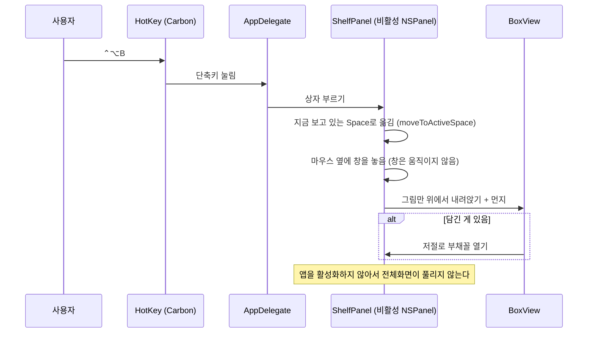
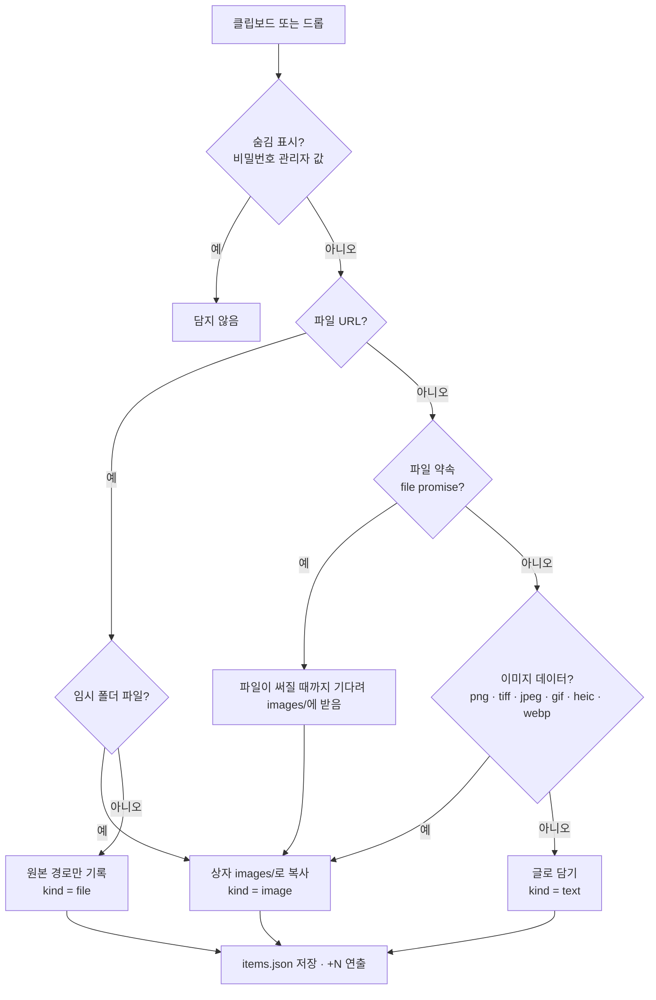
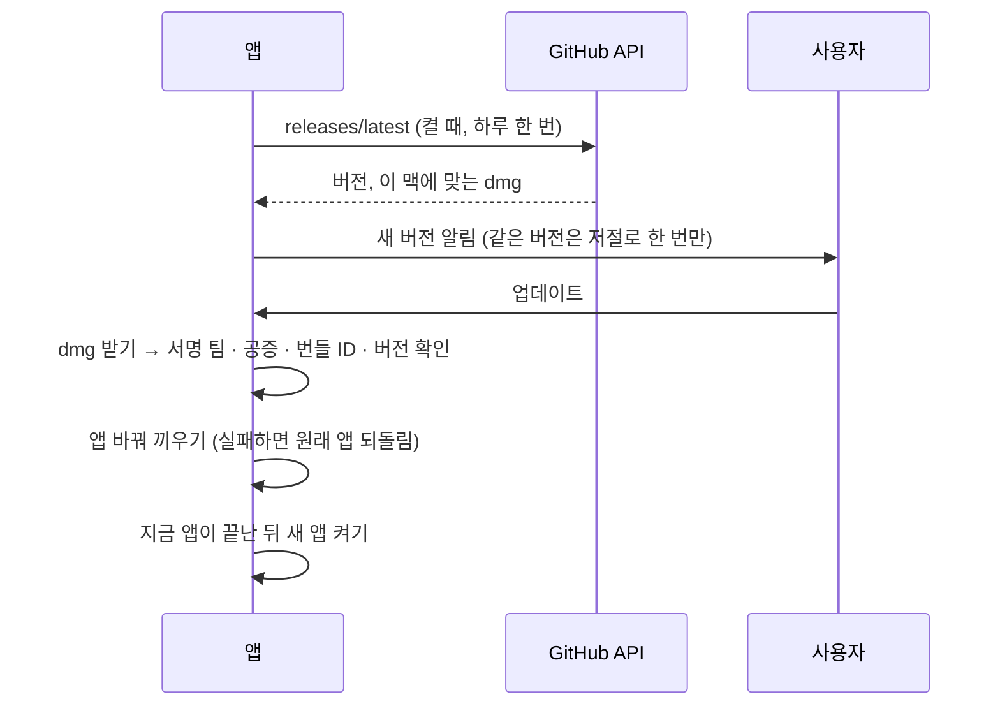

# HOPBOX(택배상자) 구현도

> 2026-11-05에 v1.0.2 코드를 보고 정리했다.
> 함께 보기: [기획서](기획서.md) · [설계서](설계서.md) · [결정기록](결정기록.md)

## 폴더 구조

```text
hopbox/
├── Package.swift            맥판 Swift 패키지 (macOS 13+, 실행 타깃 Hopbox)
├── build.sh                 .app 만들기 · 설치 · 릴리스 dmg(서명·공증)
├── Resources/               Info.plist(번들 ID com.haul.hopbox, 표시 이름 택배상자), 아이콘, 상자 그림
├── Sources/Hopbox/          맥판
│   ├── main.swift             앱 시작
│   ├── AppDelegate.swift      메뉴 막대, 전역 단축키 연결, 설정, 업데이트 메뉴
│   ├── HotKey.swift           Carbon RegisterEventHotKey
│   ├── Shortcut.swift         단축키 저장값 · 표시 이름 · 바꾸기 창 · 겹침 검사
│   ├── ShelfPanel.swift       떠 있는 비활성 패널: 배달 연출, 열기·닫기, 키보드, 드롭 받기
│   ├── BoxLayout.swift        상태별 창 크기와 아이콘 자리 (펼쳐도 상자가 튀지 않게)
│   ├── BoxView.swift          상자 아이콘 · 내려앉기 · 먼지 · +N · 알림
│   ├── FanView.swift          Dock 스택식 부채꼴
│   ├── ShelfView.swift        전체 목록
│   ├── ShelfStore.swift       상자 내용: 담기 · 복사 · 되돌리기 가능한 빼기 · 저장
│   ├── ScreenCaptureWatcher.swift  스크린샷 · 화면 기록 · 복사한 이미지 자동 담기
│   ├── DragSource.swift       복사로만 끌어내기, 클릭과 끌기 구분
│   ├── Thumbnails.swift       QuickLook 미리보기
│   ├── Log.swift              주고받은 형식 이름 기록 (내용 없음)
│   └── Updater.swift          GitHub 릴리스 확인, 서명·공증 확인 후 바꿔 끼우고 다시 켜기
├── windows/
│   ├── Hopbox.Windows/        윈도우판 (WPF, .NET 8)
│   │   ├── App.cs               한 번만 실행, 두 번째 실행은 상자 부르기, error.log
│   │   ├── Tray.cs              알림 영역 아이콘 · 메뉴
│   │   ├── HotKey.cs · Shortcut.cs · ShortcutWindow.cs  단축키
│   │   ├── BoxWindow.cs · FanView.cs · ListCard.cs      상자 창 · 부채꼴 · 목록
│   │   ├── ItemActions.cs       항목 복사 · 끌어내기
│   │   ├── Transfer.cs          클립보드 · 드롭 읽기(가상 파일, DIB, 숨김 표시)
│   │   ├── ShelfItem.cs · ShelfStore.cs  상자 내용
│   │   ├── Watchers.cs          클립보드 · 캡처 폴더 자동 담기
│   │   ├── Thumbnails.cs        셸 미리보기
│   │   ├── Settings.cs · Theme.cs · Native.cs
│   │   └── Updater.cs           SHA-256 확인 후 조용히 설치
│   ├── Hopbox.Windows.Tests/  xUnit 시험 (ShelfStoreTests.cs)
│   └── installer/hopbox.iss   Inno Setup 설치 파일
├── .github/workflows/windows.yml  윈도우 시험 · 빌드 · 릴리스 붙이기
└── docs/images/             README 그림
```

## 주요 흐름

### 단축키로 상자 부르기 (맥)



### 담기 (붙여넣기·끌어다 놓기)



- 브라우저는 이미지와 주소 글자를 같이 올리므로 글자보다 이미지를 먼저 본다. 실제 판단 순서는 [ShelfStore.swift](../Sources/Hopbox/ShelfStore.swift) 참고.

### 업데이트 (맥)



## 핵심 파일

| 파일 | 설명 |
|---|---|
| [Sources/Hopbox/ShelfPanel.swift](../Sources/Hopbox/ShelfPanel.swift) | `.nonactivatingPanel`, `.fullScreenAuxiliary`. 항목 위에서는 창 끌기(배경 잡아 옮기기)를 끄고 상자 아이콘에서만 창이 움직이게 했다 |
| [Sources/Hopbox/BoxLayout.swift](../Sources/Hopbox/BoxLayout.swift) | 아이콘은 늘 같은 화면 자리(anchor), 창은 펼친 내용만큼 그 둘레로 커진다. 창 크기를 먼저 바꾸고 화면을 나중에 바꾼다 |
| [Sources/Hopbox/ShelfStore.swift](../Sources/Hopbox/ShelfStore.swift) | 담기 판단, 임시 파일 보관, 5초 되돌리기(`undoSeconds`), 고아 이미지 정리 |
| [Sources/Hopbox/ScreenCaptureWatcher.swift](../Sources/Hopbox/ScreenCaptureWatcher.swift) | `com.apple.screencapture` `location` 따라가기, 클립보드 0.5초 확인 |
| [Sources/Hopbox/Shortcut.swift](../Sources/Hopbox/Shortcut.swift) | 기본 ⌃⌥B, 허용 조합 검사, 한글 입력 중에도 영문 자판 기준 키 이름 |
| [Sources/Hopbox/Updater.swift](../Sources/Hopbox/Updater.swift) | 맥 업데이트 |
| [windows/Hopbox.Windows/BoxWindow.cs](../windows/Hopbox.Windows/BoxWindow.cs) | 창 크기는 늘 같고 투명 부분은 클릭이 지나간다. 아이콘을 화면 안으로 당기고 펼칠 방향을 정한다 |
| [windows/Hopbox.Windows/Transfer.cs](../windows/Hopbox.Windows/Transfer.cs) | 가상 파일(실제 크기로 자르기, 크기 상한, 이름 걸러내기, 인터넷 표시), DIB 읽기 |
| [windows/Hopbox.Windows/Updater.cs](../windows/Hopbox.Windows/Updater.cs) | 24시간마다 확인, `digest` sha256 비교, `/VERYSILENT` 설치 |
| [.github/workflows/windows.yml](../.github/workflows/windows.yml) | 시험 → x64·arm64 단일 실행 파일 → 켜서 상자 부르기 시험 → 설치 파일 → 태그면 릴리스에 붙이기 |

## 빌드·실행·배포

### 맥

```bash
swift build             # 디버그 빌드
./build.sh              # build/택배상자.app
./build.sh install      # ~/Applications 에 설치하고 실행
./build.sh release      # build/release/Hopbox-macOS-{apple-silicon,intel}.dmg
# SIGN_IDENTITY="Developer ID Application: ..." NOTARY_PROFILE=<notarytool 프로필> ./build.sh release
```

- Xcode 없이 Command Line Tools만 있으면 된다.
- 서명 값이 없으면 임시 서명(`codesign --sign -`)만 하고 공증은 건너뛴다.

### 윈도우

```powershell
dotnet test windows/Hopbox.Windows.Tests      # 시험
dotnet run --project windows/Hopbox.Windows   # 실행
```

- 설치 파일은 GitHub Actions가 만든다. `windows/**`가 바뀐 push마다 돌고, `v*` 태그면 같은 이름의 릴리스에 `Hopbox-Windows-{x64,arm64}-Setup.exe`를 붙인다(릴리스가 없으면 초안 생성).

### 릴리스 순서 (히스토리에서 본 방식)

1. `Resources/Info.plist`의 버전을 올리는 커밋.
2. `vX.Y.Z` 태그 → 윈도우 설치 파일은 Actions가 붙인다.
3. 맥 dmg는 `./build.sh release`(서명·공증)로 만들어 같은 릴리스에 올린다.
4. 릴리스 파일 이름에 버전을 넣지 않는다. README의 `releases/latest/download/` 링크가 늘 최신을 가리킨다.

- 원격에는 `release/v1.0.0`, `release/v1.0.1`, `release/v1.0.2`, `feature/windows` 브랜치가 남아 있다. `develop` 브랜치는 2026-11-05 문서 작업 때 `main`에서 처음 만들었다.

## 버전·릴리스 현황

| 태그 | 날짜 | 내용 |
|---|---|---|
| v1.0.0 | 2026-10-29 | 첫 릴리스. 맥 서명·공증 dmg(애플 칩·인텔). 지금 릴리스 페이지에는 윈도우 설치 파일도 붙어 있다 |
| v1.0.1 | 2026-10-29 | 윈도우판(WPF) 포함. 기본 단축키 ⌃⌥B·Ctrl+Alt+B, 단축키 겹침 막기 |
| v1.0.2 | 2026-10-29 | 자동 업데이트와 버전 표시, 업데이트·단축키 리뷰 반영 |

- 첫 커밋 `650f83a`는 2026-10-28 20:19, v1.0.2는 2026-10-29 15:01.

## 앞으로 할 일

- [ ] 윈도우 코드 서명
- [ ] 맥판 자동 시험(지금은 없음)
