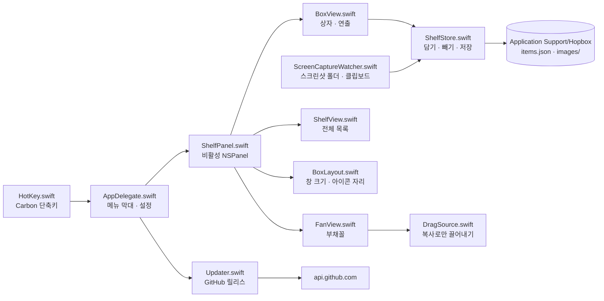
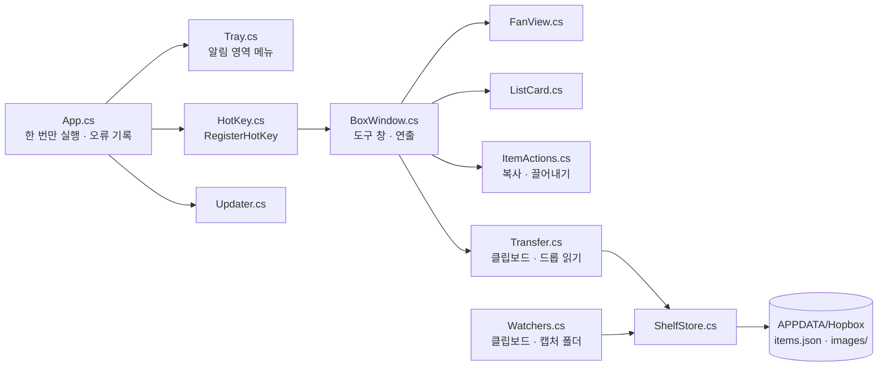

# HOPBOX(택배상자) 설계서

> 2026-11-05에 v1.0.2 코드를 보고 정리했다.
> 함께 보기: [기획서](기획서.md) · [구현도](구현도.md) · [결정기록](결정기록.md)

## 기술 스택

| 플랫폼 | 고른 것 | 이유 |
|---|---|---|
| macOS | Swift 5.9 · SwiftUI · AppKit, Swift Package Manager | 전체화면 Spaces 위에 뜨는 비활성 패널(`NSPanel` `.nonactivatingPanel`, `.fullScreenAuxiliary`)과 클립보드·드래그 형식을 직접 다뤄야 한다. Xcode 없이 Command Line Tools만으로 빌드한다(`build.sh`) |
| macOS 단축키 | Carbon `RegisterEventHotKey` | 손쉬운 사용 권한 없이 전역 단축키를 받는다 |
| macOS 미리보기 | QuickLook 썸네일 | Finder처럼 내용이 보인다 |
| Windows | C# · WPF · .NET 8, 단일 실행 파일(self-contained) | 작업 표시줄에 안 나오는 도구 창과 알림 영역 아이콘. x64·arm64 둘 다 |
| Windows 단축키·클립보드 | Win32 `RegisterHotKey`, `AddClipboardFormatListener` | 전역 단축키와 클립보드 변경 알림 |
| Windows 설치 | Inno Setup 6 | 관리자 권한 없이 사용자 폴더에 설치(`PrivilegesRequired=lowest`) |
| CI | GitHub Actions(`windows-latest`) | 맥에서 윈도우판을 빌드·시험할 수 없어서 |

### 플랫폼별 네이티브를 고른 근거

- 크로스 플랫폼 틀(Electron·Tauri 등)과 비교한 기록은 없다(기록 없음).
- 맥판이 먼저 나왔고(2026-10-28), 윈도우판은 하루 뒤 같은 기능을 WPF로 다시 만들었다(`79838d0`). 두 판은 코드를 공유하지 않는다.
- 이 앱의 핵심이 OS 고유 기능(전체화면 Spaces 위에 뜨는 비활성 창, 클립보드 형식, 드래그 파일 약속, 권한 없는 전역 단축키)이라 네이티브 API를 직접 쓴 것으로 보인다(추정).

## 전체 아키텍처

### 맥

### 윈도우

- 두 판 모두 "상자 내용(ShelfStore)"이 중심이다. 화면(상자·부채꼴·목록), 담기 경로(드롭·붙여넣기·자동 담기), 저장이 모두 ShelfStore를 거친다.

## 데이터 구조

### 상자 항목 `ShelfItem`

| 필드 | 뜻 |
|---|---|
| `id` | UUID |
| `kind` | `file`: 원본 파일 경로만 가리킨다(복사 안 함) / `image`: 상자가 보관하는 파일(붙여넣은 이미지, 곧 지워질 임시 파일을 `images/`에 복사) / `text` |
| `path` | `file`·`image`의 경로 |
| `text`, `preview`, `textLength` | 글 항목. 미리보기는 담을 때 한 번 만든다(앞 300자, 공백 정리) |
| `addedAt` | 담은 시각 |

### 저장 위치

| 플랫폼 | 위치 |
|---|---|
| macOS | `~/Library/Application Support/Hopbox/items.json`, `images/` |
| Windows | `%APPDATA%\Hopbox\items.json`, `images\`, 예상 못 한 오류는 `error.log` |

- 단축키·자동 담기 설정은 맥 `UserDefaults`, 윈도우 `%APPDATA%\Hopbox\settings.json`, 로그인 시 실행은 레지스트리 `HKCU\...\Run` 항목.
- 맥은 켤 때 `images/`에서 목록이 가리키지 않는 파일을 지운다(`removeOrphanImages`). 상자가 직접 만든 파일만 지운다.
- 윈도우는 목록 파일을 못 읽으면 보관 파일을 지우지 않고 `.bak`으로 남긴다(`5d1d17e`).
- 앱을 제거해도 담아 둔 목록과 보관 파일은 남긴다(README).

### 외부 연동

| 대상 | 쓰는 곳 |
|---|---|
| `https://api.github.com/repos/ESeungJun/hopbox/releases/latest` | 업데이트 확인(켤 때, 하루에 한 번) |
| `https://github.com/ESeungJun/hopbox/releases/download/...` | 설치 파일 받기. 이 주소로 시작하는 것만 받는다 |
| `com.apple.screencapture` 설정(`location`) | 맥 스크린샷 저장 위치 따라가기 |

## 플랫폼별 차이

| 항목 | macOS | Windows |
|---|---|---|
| 기본 단축키 | ⌃⌥B | Ctrl+Alt+B |
| 단축키 제한 | ⌃에 ⌥·⇧·⌘ 중 하나를 더한 조합. macOS 단축키와 겹치면 거부 | Ctrl·Alt·Win 중 두 개가 든 조합. 이미 전역으로 쓰이는 조합은 거부 |
| 떠 있는 창 | `NSPanel` 비활성, `.moveToActiveSpace`·`.fullScreenAuxiliary`, `level = .floating` | 작업 표시줄·Alt+Tab에 안 나오는 도구 창, 모든 가상 데스크톱에 보임. 투명 부분은 클릭이 아래 앱으로 지나감 |
| 스크린샷 감시 | `DispatchSource` 파일 감시 + 5초마다 저장 위치 바뀜 확인 | `FileSystemWatcher` + 10초마다 폴더 확인 |
| 클립보드 감시 | 0.5초마다 `changeCount` 확인 | `AddClipboardFormatListener` 알림 |
| 민감한 값 걸러내기 | `org.nspasteboard.ConcealedType` | `ExcludeClipboardContentFromMonitorProcessing`, `Clipboard Viewer Ignore`, 클립보드 기록 금지 표시 |
| 미리보기 | QuickLook | 셸 미리보기 |
| 업데이트 확인 | dmg 서명(같은 Developer ID 팀)·공증·번들 ID·버전 확인 후 앱 바꿔 끼우기, 실패하면 원래 앱 되돌림 | GitHub가 알려 준 SHA-256과 설치 파일을 맞춰 본 뒤 `/VERYSILENT` 설치, 설치 파일이 앱을 다시 켬 |
| 설치 | dmg를 열어 응용 프로그램 폴더로 끌기 | Inno Setup, `%LOCALAPPDATA%\Programs\Hopbox` |
| 서명 | Developer ID + 공증 | 없음 |
| 자동 시험 | 없음 | xUnit 시험 + CI 실행 시험 |

## 보안·권한

- 추가 권한이 필요 없다. 맥 전역 단축키도 손쉬운 사용 권한 없이 Carbon으로 받는다.
- 끌어낼 때는 늘 복사로 나간다. Finder·탐색기로 끌어도 원본이 옮겨지지 않는다([DragSource.swift](../Sources/Hopbox/DragSource.swift), [ItemActions.cs](../windows/Hopbox.Windows/ItemActions.cs)).
- 비밀번호 관리자처럼 "숨김" 표시를 단 클립보드 값은 담지 않는다. 자동 담기는 스프레드시트 셀(글 + 그림), Finder에서 복사한 파일의 아이콘 그림도 담지 않는다.
- 기록(`Log.swift`, `os.Logger` subsystem `com.haul.hopbox`)은 주고받은 형식 이름만 남기고 내용은 남기지 않는다.
- 업데이트:
  - 맥: 받은 dmg를 열기 전에 서명·공증을 확인하고, 같은 개발자 팀으로 서명된 같은 번들 ID 앱만 설치한다.
  - 윈도우: GitHub 릴리스 API가 주는 `digest`(sha256)와 받은 파일을 맞춰 본다. 다운로드 주소는 이 저장소 릴리스 주소로 시작해야 한다.
  - 조용한 업데이트가 사용자가 꺼 둔 자동 실행을 되살리지 않는다(`5abe2d0`).
- CI: 기본 권한은 읽기, 릴리스에 붙이는 작업에만 쓰기 권한. 외부 액션은 커밋 해시로 고정(`5d1d17e`).

## 알려진 한계

- 윈도우판은 코드 서명이 없어 처음 실행할 때 SmartScreen 경고가 뜰 수 있다.
- 맥은 다른 앱의 전역 단축키를 알려 주지 않는다. 겹치면 사용자가 상자 단축키를 바꿔야 한다.
- `file` 항목은 원본 경로만 가리킨다. 원본을 옮기거나 지우면 상자에서 찾지 못한다.
- 앱마다 클립보드·드래그 형식이 달라서, 새 앱에서 이미지가 안 담기면 형식 기록을 보고 맞춰야 한다.
- 윈도우판은 시스템 DPI 기준으로 동작한다(모니터별 DPI 미사용, [BoxWindow.cs](../windows/Hopbox.Windows/BoxWindow.cs) 주석).
- 맥판에는 자동 시험이 없다.
